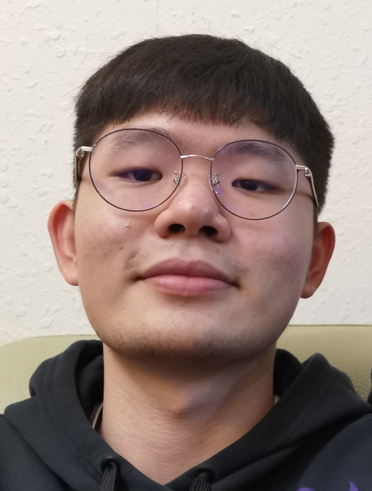
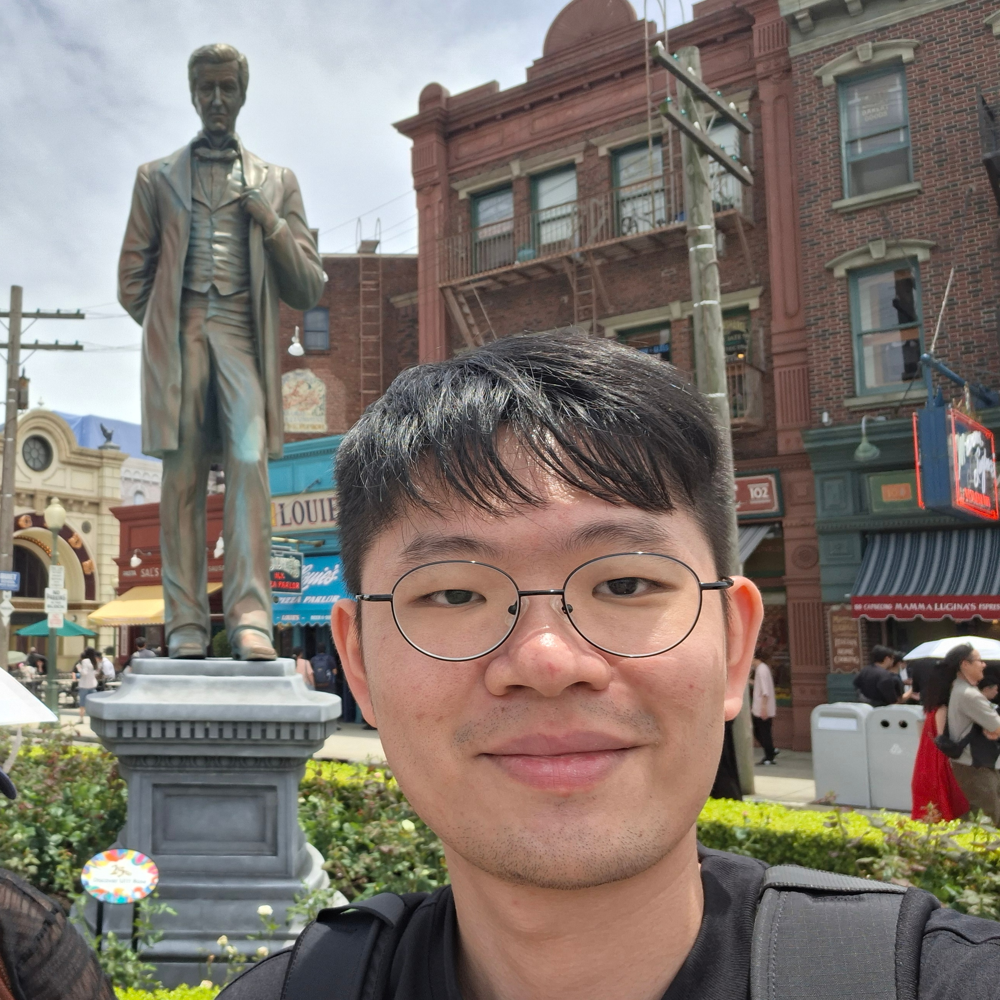
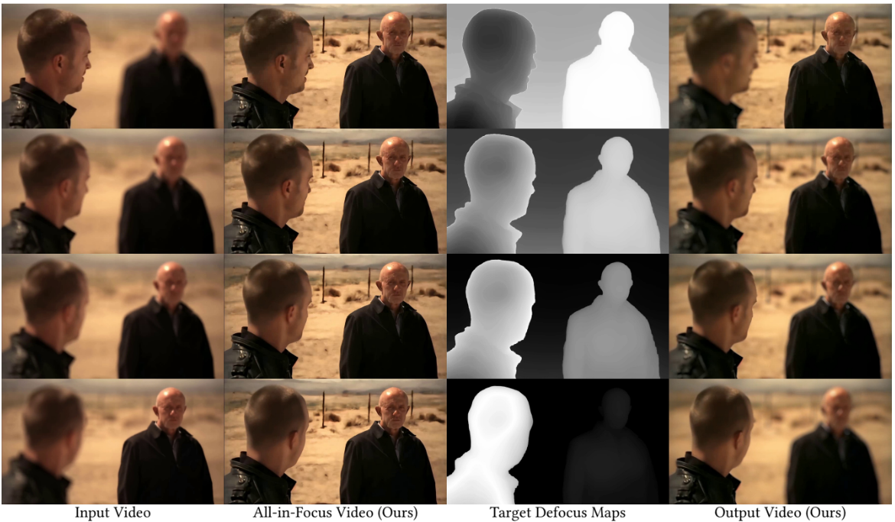
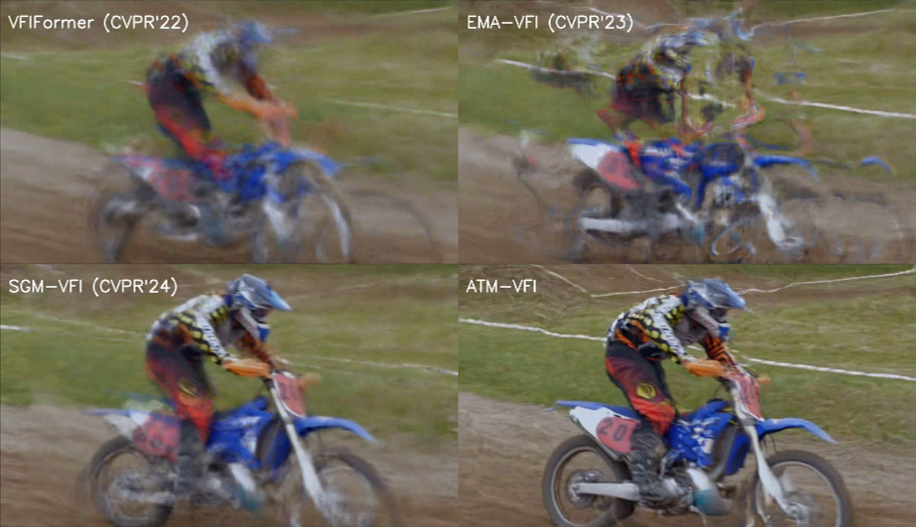
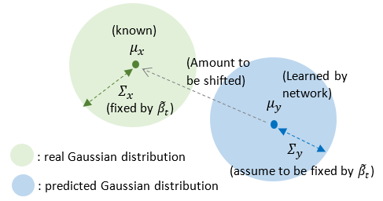

### (Kenny) Chee Kim, Gan | 顏子鈞

 

<!--  -->

I was born and raised in Malaysia until 18, before I lived in Taiwan for 8 years. Now I am staying in Los Angeles.

I am a first year Ph.D student in Electrical and Computer Engineering at the University of Southern California (USC), supervised by Prof. [C.-C. Jay Kuo](https://viterbi.usc.edu/directory/faculty/Kuo/Chung-Chieh). Previously, I served as a RA at Academia Sinica, working with Dr. [Jun-Cheng chen](https://homepage.citi.sinica.edu.tw/pages/pullpull/index_en.html). I earned my B.S and M.S from National Taiwan Univeristy (NTU) in Electrical Engineering, and I was fortunate to worked with Prof. [Jian-Jiun Ding](https://ee.ntu.edu.tw/en/article/teacher.person/jobSN/3/navSN/356/webSN/385/teacherSN/1) on Image/Video Signal Processing.

 

google scholar:       
USC MCL:

##### Research Interests
My research interests span from low-level (image/video signal processing, computer vision) to high-level (computational imaging, generative AI) vision tasks.  
My current research project works on image codec.

##### Hobbies
I enjoy coffee, running, badminton, basketball, and watching animes/movies, solving puzzles when I am free.

##### Experiences
I gained valuable industry experiences at Novatek, MediaTek, and MobileDrive.

- **Novatek** `(full-time)`: Served as System-on-Chip Algorithm Engineer. I designed both hardware and software algorithm for camera SoC, mostly focusing on HDR imaging algorithms.
- **MediaTek** `(internship)`: I interned at the video codec standard team, had some hands-on experience on H.265 and H.266.
- **Mobiledrive** `(internship)`: I interned at the Advance Driver Assistance System (ADAS) team. Mostly doing software integration for Bird-Eye-View 3D object detection & tracking.

---
##### Contact

- **Email**: [gankenny26@gmail.com](mailto:gankenny26@gmail.com)  or  [cheekimg@usc.edu](mailto:cheekimg@usc.edu)
- **LinkedIn**: [LinkedIn](https://www.linkedin.com/in/gancheekim/)

---
#### News

- (2026 Aug) One paper is accepted to Siggraph Asia 2026.
- (2026 Mar) I have been accepted to USC ECE Ph.D.

---
#### Publication

  
  

    <a href="https://gancheekim.github.io/kennygan.github.io/">Refocusing Any Video: Temporally Consistent Video Refocusing for Dynamic Focal Planes</a> (<a href="https://aiiu-lab.github.io/Refocusing-Any-Video/">Project Page</a>) (<a href="https://github.com/aiiu-lab/Refocusing-Any-Video">GitHub</a>) 
    <strong>Chee Kim Gan</strong>, Pin-Yen Chiu, I-Sheng Fang, Jun-Cheng Chen 
    SIGGRAPH Asia 2026
  

  
  

    <a href="https://ieeexplore.ieee.org/document/10890198">Exploiting Attention-to-Motion via Transformer for Versatile Video Frame Interpolation</a> (<a href="https://github.com/Gancheekim/ATM-VFI">GitHub</a>) 
    <strong>Chee Kim Gan</strong>, Jian-Jiun Ding, Chang-Yu Hsieh, De-Yan Lu 
    ICASSP 2025
  

[Adaptive face detection algorithm in blurring scenarios](https://www.spiedigitallibrary.org/conference-proceedings-of-spie/13510/3057554/Adaptive-face-detection-algorithms-in-blurring-scenarios/10.1117/12.3057554.short)  
Yi-Wei Tsai, **Chee Kim Gan**, Jian-Jiun Ding  
IWAIT 2025  

--- 
#### Article

  
  

    <a href="https://hackmd.io/@GanCheeKim99/tutorial-DM-2023">A Tutorial for Diffusion Model in 2023</a> 
    A comprehensive review of theory, architectures, applications, and video generation of the Diffusion Models (up to June 2023)
  

---
*Last updated: 2026/10/30*
